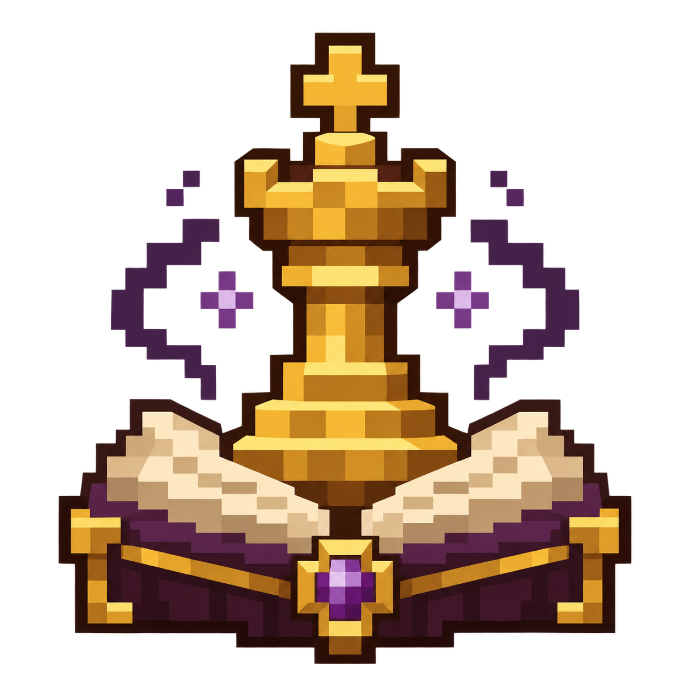
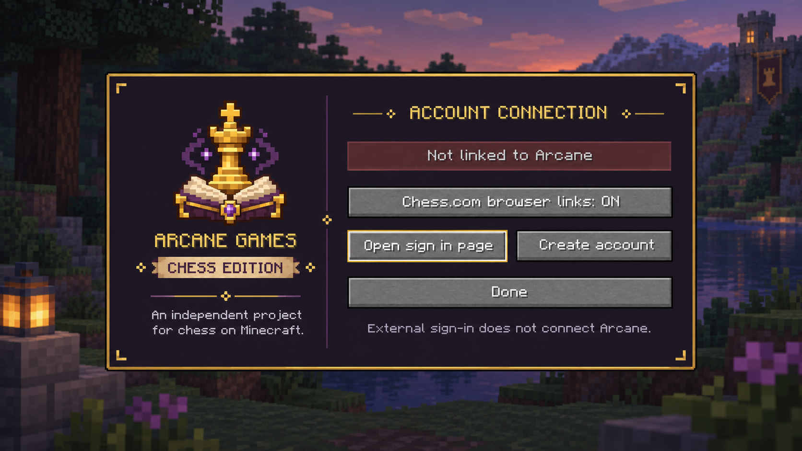

# Arcane Games emblem concept

This is a generated visual concept, not a final Minecraft texture or trademark. It suggests a stepped gold king emerging from an amethyst-bound spellbook. The Mod Menu screen uses a small code-drawn pixel emblem so it stays sharp at every GUI scale. Before publishing, redraw the concept as a hand-authored 16×16 or 32×32 pixel-art icon and verify the transparent edges in-game.

## Chess.com options screen

This generated image is a layout reference, not a screenshot of the implemented UI. The screen keeps Minecraft's native buttons and font, while using a compact two-column parchment-and-ink panel. The left side carries Arcane identity; the right side clearly separates browser-link controls from account status. Sign-in and registration open through Minecraft's external-link confirmation screen. The text says the account is not linked to Arcane, because external sign-in alone does not authenticate the mod.
